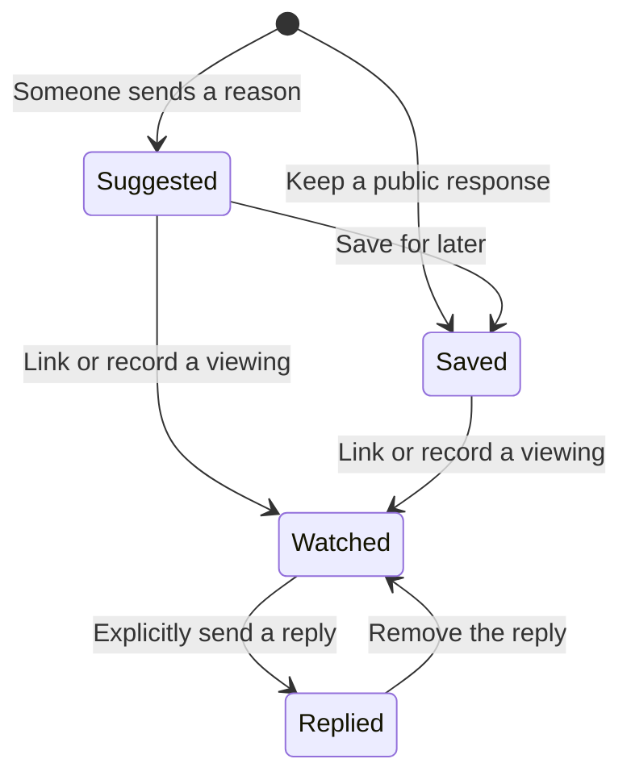

# Personal recommendations

Status: implemented for the native iPhone client and shared Express API. Research: [Beli findings](BELI_RESEARCH.md). Contract: [OpenAPI 3.1.1](api/suggestions.openapi.json). Decision date: 2026-09-21.

## Problem and outcome

A bookmark remembers a title but often loses the person and the reason. A public response does not tell someone what happened to their particular suggestion. Moodie keeps a recommendation between two people, connects it to an actual viewing, and makes a considered reply the natural continuation after saving.

## Product model

| Concept | Meaning | Presentation |
| --- | --- | --- |
| Sent recommendation | A person deliberately chooses a recipient and writes why this title is for them. | From Ananya; original personal reason. |
| Discovered recommendation | The viewer keeps a film through another person's public response. This is not an endorsement addressed to the viewer. | Through Ananya; live source response, never an invented personal message. |
| Viewing | The existing diary record. Enjoyment and memorable details supplement words and independent emotional intensities. | Loved it / Liked it / Mixed feelings / Not for me; optional highlights; tap feelings, disclose intensity sliders. |
| Reply | An explicitly shared reaction to a linked viewing. It is separate from the diary's visibility and note. | Recipient chooses enjoyment, highlights, a new note, spoilers, and whether to include feelings. A preview shows what will be sent. |
| Conversation | Participant-only messages on this particular recommendation. | Between you two; spoilers hidden; authors can delete their messages. |

Enjoyment is not a film score. Sadness can accompany loving a film; joy does not imply liking it. The existing recommendation model still uses reviewed emotional evidence. This change does not silently retrain that model on enjoyment, messages, or private replies.

## State and privacy

Archive is a separate recipient-only flag, available at every state and reversible. Unsave affects the existing saved library, not the recommendation's reason or conversation. Deleting a viewing removes its linked reply and clears the viewing association; the recommendation survives. A different viewing can be linked after removing the old reply. Editing a reply can replace its explicitly shared payload.

The server projects state per viewer. The sender sees **Sent** until a reply exists, never the recipient's private save, archive, viewing ID, or watched status. A discovered save is invisible to its source until the viewer sends a reply. There are no read receipts, invented unread badges, deadlines, streaks, ranks, or match percentages.

The first explicit reply opens a conversation permanently. Retracting a reply removes its contents, but preserves the participants' access to messages they exchanged and their ability to delete their own messages. A discovered conversation then shows **Conversation** to the source person, without revealing the viewer's diary state. The API exposes `conversation_open` for clients instead of asking them to infer permission from the current reply. Entry-ID filters are restricted to the viewer's own linked entries, including when another inbox filter is supplied.

Direct recommendations can go to people who follow the sender. This prevents unsolicited recommendation inboxes. Discovery and private capture require no invitations, follows, or minimum diary size. Each sender/recipient/title/origin has one conversation, so a repeated send reopens the existing record instead of creating duplicates. Sent and discovered origins can coexist without rewriting history.

## Native entry points and journey

1. **Home:** a small recommendations section and inbox toolbar action; existing people-led discovery stays available.
2. **Film:** recommend to a person; see recommendations already received for this film.
3. **Public response or recommendation evidence:** keep the recommendation with exact source attribution.
4. **People/profile:** open recommendations between the two people; recommend from a profile when receiving permission exists.
5. **Inbox:** received, sent, archived; search by person, title, or reason; paginated history.
6. **Recommendation:** original person/reason; save, archive, record or link a viewing; read source response; compose/edit/retract a reply; continue the conversation; recommend onward with a fresh note.
7. **Composer:** optional attribution selection, enjoyment and highlights, simple feeling choices, optional precise intensity, existing date/privacy/photo/draft controls.
8. **Saved viewing:** direct invitation to tell the source person how it landed; can return later without sending.
9. **Diary/film history:** attribution links back to the recommendation. Existing saved films are preserved.
10. **Activity:** received recommendations, explicit replies, and conversation messages link to the exact record. Spoiler message previews are omitted.

## Data and authorization

`diary_entries` remains the atomic viewing record. Additive nullable enjoyment and optional highlights preserve older clients. `film_suggestions` holds participants, title, origin, authored reason, source response reference, linked viewing, private archive state, and the first explicit sharing timestamp. `suggestion_replies` holds the explicit reply and optional feeling snapshot. `suggestion_messages` holds participant-authored discussion.

- Sender and recipient identity are server-validated. Direct sources must be the sender's public response to the same title. Discovered sources must be public and visible to the viewer.
- Only the recipient can save/archive/link/reply; a linked viewing must be their own and for that exact film.
- Private diary text and photos are never copied into replies. The reply form starts with a blank note. Enjoyment/highlights are editable before sending; feelings default off.
- Explicitly shared reply text/feelings are a separate message. Changing diary privacy does not retract that message; **Remove my reply** does. Deleting the linked viewing retracts it automatically.
- Source response evidence is read live. Making the source private, deleting it, or moderating it removes that evidence from the recommendation. An authored personal reason remains the sender's separate message.
- Blocks work in either direction for every read and mutation. Removed accounts cascade their recommendation conversations while leaving other people's diary records intact.
- The existing report-person and block controls apply. Production moderation of private recommendation conversations needs an explicit operator workflow before release; the current command-line moderation tool has no conversation-specific review screen.

## HTTP contract and retries

All requests use existing cookie sessions; mutations also require `X-Moodie-Request: 1`. Inputs use camelCase, row fields use snake_case, envelope pagination retains `nextOffset`. Native decoding uses `convertFromSnakeCase`.

| Method and path | Purpose |
| --- | --- |
| GET `/api/suggestions/recipients?q=` | Search eligible recipients. |
| GET `/api/suggestions` | Page by box, person, title, linked entry, and literal search. |
| POST `/api/suggestions` | Send deliberately or keep a public response. |
| GET `/api/suggestions/{id}` | Participant-specific projection of a recommendation. |
| PATCH `/api/suggestions/{id}` | Save, archive, restore, or link a viewing. |
| PUT / DELETE `/api/suggestions/{id}/reply` | Share/edit or retract the explicit reply. |
| GET / POST `/api/suggestions/{id}/messages` | Read a paginated conversation or send a message. |
| DELETE `/api/suggestions/{id}/messages/{messageId}` | Delete an author's own message. |

Diary create accepts optional `suggestionId` and UUID `clientRequestId`. Viewing creation and attribution commit in one transaction. Retrying the same UUID/payload returns the same viewing. Reusing it with changed content returns 409. Older clients may omit it and retain their current behavior. Native drafts retain that UUID across relaunches; legacy drafts decode without it and receive a key when resumed. Message sends also use a stable UUID per payload; identical retries do not duplicate. Reply PUT is idempotent for an unchanged payload and does not generate a new activity timestamp.

Activity remains compatible with web: `includeSuggestions=true` opts into the three new event kinds and their `suggestion_id` links. There is no push delivery or email sending in this implementation.

## Architecture decision: a portable contract, native presentation

Use [OpenAPI 3.1.1](https://spec.openapis.org/oas/v3.1.1.html), existing Zod 3 validation, Swift Codable models, and native SwiftUI. The quick library check found that Zod's built-in JSON Schema conversion is documented for the newer [Zod API](https://zod.dev/json-schema); upgrading the existing validation stack solely for this feature is unnecessary. The small OpenAPI document is maintained with the routes. No workflow engine, state-machine dependency, generated SDK framework, or UI library was added.

For web: consume the same endpoints and projections, preserve the sent/discovered wording, put the chooser in the web response editor, and add a reply continuation after successful saving. Use the contract to generate TypeScript types if desired; state, privacy, deduplication, and authorization stay on the server. Do not infer receipt or reply state from local UI.

## Acceptance and boundaries

API tests exercise the two-person lifecycle, privacy, same-title ownership, blocks/moderation, source retraction, retries, archive/restore, deletion, and pagination. Native core tests exercise old-draft compatibility, stable retry keys, attribution encoding, and reply decoding. Simulator acceptance exercises send, viewing, reply, private-note exclusion, and relaunch. Current results are in [native verification](../ios/VERIFICATION.md).

This pass uses the existing film catalog. TV catalog identity and season/episode progress are not implemented by this lifecycle change. The relationship and reply model can apply to shows, but a web or TV extension must introduce explicit media identities before treating TMDB movie and TV IDs as interchangeable. Existing web screens, public deployment, push notifications, signing, and App Store release are separate work.
