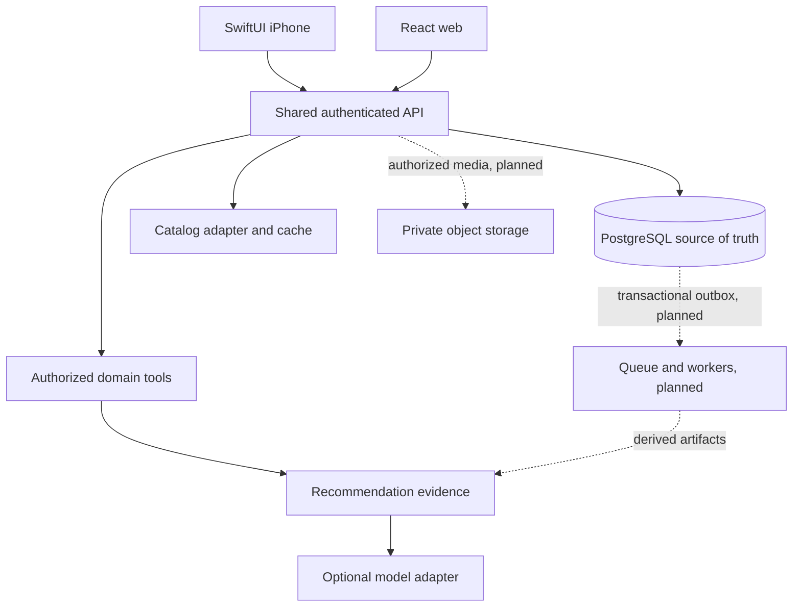

# ADR 0001: Product data, AWS deployment, and model-independent AI

Date: 2026-09-25  
Status: Accepted for application boundaries; AWS service selection and provisioning remain deferred.  
Scope: Moodie's existing film product, native iPhone app, web app, and shared API.

## Decision

Keep SwiftUI for iPhone, React/TypeScript for web, and the TypeScript/Express backend as a modular application. Use PostgreSQL as the production source of truth, with AWS as the deployment target. Introduce asynchronous processing for slow or derived work when that infrastructure is scoped. Keep the recommendation algorithm separate from an optional language-model explanation layer. Models use authorized domain tools rather than database access.

Do not rewrite the web or entire backend in Rust now. Rust is a useful future implementation choice for a measured compute bottleneck. It does not translate SwiftUI into browser UI. Share HTTP contracts, fixtures, domain semantics, and recommendation evidence across clients. Share a compiled Rust core only if a substantial computation must actually run in both clients and justifies maintaining Swift bindings and WebAssembly packaging.

This is a consumer social discovery application with a private personal journal, a relationship graph, a catalog, and an evidence-based recommender. Most core operations are relational online transactions and paginated reads. Timestamps are essential, but they do not make this primarily a time-series database workload. Social edges do not yet require a separate graph database. AI does not require making a vector store the primary database.

## Research and what transfers

Sources checked September 25, 2026. Hiring descriptions indicate technologies in use, not the complete architecture or proven capacity. Historical engineering accounts are evidence about their workload, not universal prescriptions.

| Source | Verified finding | Implication for Moodie |
| --- | --- | --- |
| [Beli's own backend infrastructure role](https://beli.breezy.hr/p/893b5379a9f6-senior-backend-infrastructure-engineer) | Python/Django, Postgres, GCP, Cloud Tasks, Docker, GitHub Actions, TypeScript/Angular. The role emphasizes query performance, background jobs, observability and reliability. | A similar product uses a relational core with ordinary web technologies. Copy the separation of concerns, not its cloud vendor or language. |
| [Beli engineer Jordan Sanz's account](https://www.jordansanz.me/assets/resume-ebe81e01.pdf) | Self-reported work in 2025–2026 includes PySpark recommendations, Django/Cloud Run, Cloud Tasks notifications, pooling/read replicas and Locust load tests. | Independent serving, offline/async work and measured bottlenecks matter. His throughput figures are self-reported, not a benchmark for this app. |
| [Letterboxd's own backend hiring description](https://nz.linkedin.com/jobs/view/senior-backend-developer-java-%2B-web-at-letterboxd-4397612989) | Java, PostgreSQL, JSP, HTML and JavaScript/TypeScript; HTTP, Servlets and JAX-RS experience. | A film diary/social network is compatible with a conventional relational backend. This source does not establish Letterboxd's current cloud topology or native app stack. |
| [Hardcover founder Adam Fortuna's 2025 review](https://adamfortuna.com/2025-year-in-review) | The reading community moved from Next.js to Rails and adopted Kubernetes during 2025. | Framework choice depends on the team's working experience and operational needs. This is not evidence that we should replace our React client, adopt Rails, or need Kubernetes. |
| [Discord's 2020 Rust read-state migration](https://discord.com/blog/why-discord-is-switching-from-go-to-rust) | Rust addressed measured GC latency in a very hot service holding large in-memory state. | A good case for selectively changing a bottleneck, not for assuming all API endpoints need Rust. Its traffic and data shapes differ sharply from ours. |
| [Spotify's Home personalization account](https://engineering.atspotify.com/2020/1/for-your-ears-only-personalizing-spotify-home-with-machine-learning) | Personalized Home separates candidate generation and ranking. | Keep candidate retrieval, ranking, evidence and explanation distinguishable. Do not copy Spotify's infrastructure scale or assume engagement alone measures recommendation value. |

Beli's public materials and these engineering sources do not establish a supported public API for us to depend on. Letterboxd publishes [API documentation](https://api-docs.letterboxd.com/), but [access is by request and excludes recommendation and LLM/GPT projects at present](https://letterboxd.com/api-beta/). Neither is a backend dependency for Moodie. See `BELI_RESEARCH.md` for interaction research.

## Why this language choice

| Layer | Choice | Reason and reconsideration trigger |
| --- | --- | --- |
| iPhone UI | SwiftUI + Codable | Existing native journeys and platform behavior. The wire contract is the portable part. |
| Browser UI | React + TypeScript | Existing accessible controls, routing and browser storage. [Rust/Wasm](https://rust-lang.org/what/wasm/) can supplement a specific computation; it does not remove browser layout, accessibility or UI work. |
| Interactive API | TypeScript + Express | Most work waits for indexed queries and external services; one shared validation/authorization layer already exists. Keep request work bounded. |
| Recommendation computation | Current TypeScript service, extract worker boundary before growth | Training and corpus scans currently run in the request process. Move training and candidate preparation off interactive requests; choose Python for an ML ecosystem need or Rust for demonstrated CPU/memory gains. Preserve evidence schemas and evaluation fixtures. |
| Production database | PostgreSQL | Transactions, unique constraints and foreign keys fit ownership, follows, viewings and reply linkage. [PostgreSQL constraints](https://www.postgresql.org/docs/current/ddl-constraints.html) enforce integrity independently of the calling language. |

Rust's memory safety and lack of GC are useful properties. They do not automatically fix broken authorization, SQL injection, model prompt injection, stale caches, leaked media, or unsafe dependency behavior. TypeScript also needs runtime validation at every external boundary. A rewrite would add migration and parity risk before we have load measurements. [Node's own guidance](https://nodejs.org/learn/asynchronous-work/dont-block-the-event-loop) supports moving long CPU tasks away from interactive request handling.

## Major requests and stored data

Expected traffic is read-heavy, but the mix below is a planning hypothesis, not production telemetry.

| User action | Request / consistency | Data and serving strategy |
| --- | --- | --- |
| Open Home / Following / Activity | Many bounded reads; exact response and conversation links | Indexed responses, follows, likes, comments and suggestion events. Cursor chronological feeds. Privacy and blocks are checked before returning a page. |
| Search or open a film | Catalog query/detail, public responses, owner status, related films | Cache permitted catalog metadata by provider identity. Load human responses independently of catalog/related failures. Do not proxy poster bytes through the API unnecessarily. |
| Record / edit / delete a viewing | Transactional write; immediate owner read | One row per viewing, watched date distinct from creation/publication time, note, visibility, chosen feelings, enjoyment, highlights. Stable create request ID makes retries safe; rewatch is a new record. |
| Save a film / use Diary | Small idempotent mutation; paginated owner reads | Saved-film uniqueness, diary indexes by owner/date/film, authoritative summary rather than client counting downloaded history. |
| Recommend / reply / message | Participant-authorized transaction | Sender, recipient, film, source response, reason, private recipient linkage, explicit reply, separate message records and retry keys. A direct recommendation and a discovered source save are distinct. |
| Follow / block / report | Small transactional mutation; prompt visibility change | Directed edges, block edges, moderation queue/actions. Blocks remove follows in both directions. Cached evidence cannot bypass current visibility. |
| Ask why / ask for a feeling | Bounded evidence read, optional slow model request | Algorithm version, source response IDs, shared film, selected feelings and human words the caller may see. No model call is required for logging, browsing or deterministic explanations. |
| Background processing | Retryable jobs | Candidate refresh, model training, catalog refresh, notification delivery and media processing. These must not delay a committed diary write. |

Account email, password/recovery hashes and session-token hashes are restricted account data. Optional expression photos are currently data URLs in `entry_media`, not S3 objects. That is a concrete migration task: store media bytes in private object storage, keep metadata/object keys in PostgreSQL, and issue authorized short-lived delivery URLs. Visibility changes/deletions require revocation and cache policy; a private response must never depend on an unguessable public URL.

Time-series/event analytics are derived data: recommendation impressions, explicit saves, completed viewings, replies and optional quality feedback. Record event time and ingestion time separately; deduplicate event IDs, define retention, and minimize text/PII. Do not turn “saved” or “viewed” into a fabricated positive preference. Do not copy private notes into analytics or training by default. The current learner uses numerical self-reports, with temporal evaluation described in `LEARNED_RECOMMENDATIONS.md`.

## Serving on AWS

The diagram mixes implemented application boundaries with explicitly marked future infrastructure. It is not a deployment diagram of a running AWS environment.

The later deployment review should start with managed PostgreSQL, containerized API/worker processes, private object storage and a queue. Likely AWS mappings are RDS PostgreSQL, ECS/Fargate, S3 and SQS, plus CloudFront for eligible static/media delivery. These are candidates, not provisioned choices or a cost commitment. [RDS PostgreSQL](https://docs.aws.amazon.com/AmazonRDS/latest/UserGuide/CHAP_PostgreSQL.html) is the direct relational fit; evaluate Aurora, Lambda or other alternatives against available resources, traffic, connection handling and budget. No need to introduce EKS, Kafka, DynamoDB, Neptune or a vector database without a demonstrated requirement.

Keep authoritative writes synchronous. When a committed change must trigger work, write an outbox record in the same transaction and deliver it asynchronously. Use event IDs, aggregate/version IDs, retry budgets and idempotent consumers. Do not promise exactly-once business effects merely because a queue deduplicates messages. [AWS's transactional outbox guidance](https://docs.aws.amazon.com/prescriptive-guidance/latest/cloud-design-patterns/transactional-outbox.html) explains the database/message dual-write failure this avoids. We are not adopting event sourcing as the source of truth.

No outbox/queue is implemented yet. Session and auth-throttle records already live in the database; verify expiration cleanup, concurrent updates and transaction behavior against hosted PostgreSQL before replicas. Use shared storage, bounded pools per process, request deadlines, query timeouts, separate migration execution, backups and restore drills. AWS IAM/secrets, region, costs, availability targets and network topology belong in the deferred deployment review.

## AI is a capability, not the data owner

The recommender produces candidates plus evidence. A language model can interpret a user's request, retrieve authorized facts, compare people's responses and explain a path. It cannot establish a person's consent, invent a friend's endorsement, or decide whether a private response is visible.

The implemented foundation is in `server/src/assistant/`:

- A JSON Schema tool catalog and executable, capability-scoped `recommendation_evidence` and `read_public_response` tools. Context comes from authenticated application code; arguments cannot substitute another account ID. Outputs are bounded previews and exclude private diary text and photos. Public words are untrusted content.
- A provider-independent `ExplanationProvider` interface with structured output, source IDs, cancellation and an eight-second model budget. A deterministic evidence explanation works with no provider. External inference is off unless application code explicitly enables it.
- Explanation evidence is re-read after model completion or failure. Changed/removed evidence discards the model output. Invalid shapes and invented source IDs fall back to current facts. This is a consistency check, not a semantic truth detector: each provider still needs grounding, prompt-injection, privacy and quality evaluations.

These are internal modules, not a deployed chatbot or remotely accessible MCP server. No model SDK, credential, provider request or inference bill is introduced. Mock-provider tests prove the adapter contract, not real OpenAI/Anthropic/local-model compatibility. Provider adapters must implement the same fixtures before activation, with their own retention policy, token/cost limits, structured-output mapping and telemetry. Do not silently fail over private data to another provider.

OpenCode is an agent client/runtime, not a model family: its [provider documentation](https://opencode.ai/docs/providers/) and [MCP support](https://opencode.ai/docs/mcp-servers/) provide integration paths. Later expose the same domain tools through [MCP tool schemas](https://modelcontextprotocol.io/specification/2025-11-25/server/tools) with [proper authorization](https://modelcontextprotocol.io/specification/2025-11-25/basic/authorization), or translate them into provider-native function calls. MCP is a transport contract; it does not replace our permission checks. OpenAI, Anthropic, Bedrock or a local inference adapter must never receive raw database credentials.

Explain the actual recommendation path with citations and limitations, not a model's hidden chain of thought. Store model/provider version, algorithm version, evidence IDs, tool names, outcome and latency/cost when added; avoid logging private prompts, secrets or unnecessary message bodies. Any future write tool must call existing domain services, revalidate authorization, use stable idempotency keys and present the concrete proposed action before a user approves sending, following, publishing or deleting. Read tools do not confer write authority.

[Anthropic's engineering account](https://www.anthropic.com/engineering/building-effective-agents) supports starting with simple composable workflows. Its 2024 advice is historical and now annotated by the author as evolving; we use the separation principle, not its old SDK/tooling details. Ordinary discovery should remain useful if every model provider is offline.

## Growth gates and current debt

The current PGlite database is single-process, protected by a filesystem lock. It is not a production PostgreSQL connection pool and cannot be shared by API replicas. `DatabaseClient` is the adapter seam, not proof of hosted-database compatibility.

The largest code-level scaling risk is `recommendationEngine.loadContext`: it reads the visible corpus, constructs peer paths, and can train in the serving process. Capping tool/UI output does not cap this computation. Before broad launch, move training to versioned background artifacts, introduce bounded candidate retrieval, and revalidate visibility on serving. A cache must include account/intent/model and visibility invalidation; TTL alone is insufficient for private or blocked content.

Other pending work includes unbounded legacy profile/comment/film reads, remaining native paging, media migration, real database migrations and backup recovery. See `PLATFORM_ALIGNMENT.md` for current progress. Offset pagination is acceptable for small lists with refresh/deduplication; move high-write lists to stable cursor contracts as measured.

Capacity planning should use measured sessions, screen requests, writes, image bytes and model invocations. Example only: 10,000 daily active people × 3 sessions × 12 interactions × 2 API reads is 720,000 reads/day, about 8.3/sec on average or 83/sec at an assumed 10× peak. This is not our observed traffic or a capacity claim. Recommendation CPU, query fan-out and image bandwidth may dominate despite a low average. Load-test representative feed, save, reply, block and explain mixes; track p50/p95/p99, error rate, DB pool wait, slow queries, queue age, event-loop delay and provider cost. Establish budgets with the deployment scope, then use measurements to justify a worker split, cache, index, replica or Rust component.

## Git and rollout

Work is on `codex/platform-alignment-aws-ai`. The checkout already contained extensive uncommitted native/backend work; preserve it, avoid blanket staging, and keep architecture records separate from implementation commits. Contract changes must remain additive until both clients migrate. Regenerate declarations, test runtime privacy/transactions, build both clients, and review migration/rollback boundaries before release. Local tests, commits, pushes, AWS deployment and public access are separate evidence.
